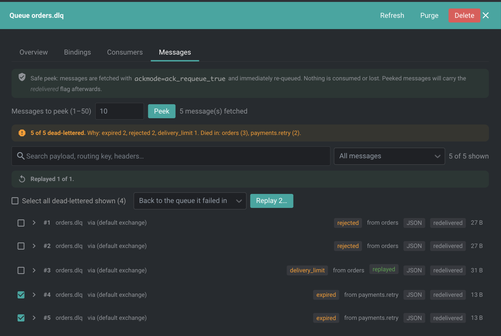

# @freelensapp/rabbitmq-extension

<!-- markdownlint-disable MD013 -->

[](https://freelens.app)
[](https://github.com/freelensapp/freelens-rabbitmq-extension)
[](https://deepwiki.com/freelensapp/freelens-rabbitmq-extension)
[](https://github.com/freelensapp/freelens-rabbitmq-extension/releases)
[](https://github.com/freelensapp/freelens-rabbitmq-extension/actions/workflows/unit-tests.yaml)
[](https://github.com/freelensapp/freelens-rabbitmq-extension/actions/workflows/integration-tests.yaml)
[](https://www.npmjs.com/package/@freelensapp/rabbitmq-extension)

<!-- markdownlint-enable MD013 -->

## Overview

[Freelens](https://freelens.app) extension for **RabbitMQ**: a cluster-native
RabbitMQ console inside the tool you already use for the cluster.

The extension discovers the RabbitMQ clusters running in the Kubernetes
cluster you are connected to, reads their credentials from the Secrets the
operator or the chart created, opens a port-forward to the Management API and
lets you inspect queues, exchanges, bindings, connections, channels,
consumers and messages, **read-only by default**. Everything lives in the
cluster sidebar under **RabbitMQ**: **Clusters**, **Overview**, **Health**,
**Queues**, **Exchanges** and **Connections**.




The extension is modelled on the
[freelens-kafka-extension](https://github.com/freelensapp/freelens-kafka-extension)
architecture, tailored for RabbitMQ.

## Requirements

- **Freelens >= 2.0.0** (extension API v2). Freelens 1.x needs the 0.4.x
  releases of this extension.
- **RabbitMQ management plugin** enabled on the brokers. It is included in
  the `*-management` images, in the RabbitMQ Cluster Operator and in the
  Bitnami chart.
- **Kubernetes access** through the Freelens connection to the cluster.
  Discovery reads `RabbitmqCluster` resources, Services, workloads and
  Secrets through it, and the port-forward runs the kubectl Freelens runs for
  the cluster with the proxy kubeconfig Freelens gives it, so it
  authenticates the way the cluster connection does (including `exec`
  plugins) and needs the `pods/portforward` permission.
- **Node.js** is required only when building the extension from source; it
  is not needed to run it. The package is a self-contained bundle.

## Supported sources

<!-- markdownlint-disable MD013 -->

| Source | Found through | Credentials |
| --- | --- | --- |
| RabbitMQ Cluster Operator `RabbitmqCluster` resources | CRs and their client Service | The `<cluster>-default-user` Secret, the operator CA Secret for TLS listeners |
| In-cluster Services exposing the Management API (`15672`/`15671`) | Services next to AMQP (`5672`/`5671`): Bitnami charts, hand-rolled StatefulSets | The Secret referenced by `RABBITMQ_DEFAULT_USER/PASS` or `RABBITMQ_USERNAME/PASSWORD` on the workload |
| Any discovered target | The error panel of the target | Manual username and password, held in the Main process for the session only |

<!-- markdownlint-enable MD013 -->

Passwords are never sent to the renderer, never persisted and never logged.

## Installation

Open the Freelens **Extensions** page (`ctrl`+`shift`+`E` or
`cmd`+`shift`+`E`). The field at the top takes a package name, the URL of a
tarball, or the path to a tarball or a directory. Install by npm name:

```text
@freelensapp/rabbitmq-extension
```

Alternatively, each
[GitHub release](https://github.com/freelensapp/freelens-rabbitmq-extension/releases)
has the extension as a `.tgz` with its checksum in a `.tgz.sha256` next to it.
Enter the URL of the `.tgz`, or download both files into one directory and
enter the path to the `.tgz` or drop it on the Freelens window; Freelens
checks the tarball against the checksum.

You can also build the extension yourself and install it from your checkout,
see [Build from the source](#build-from-the-source).

## Getting started

1. Connect to a cluster in Freelens. A **RabbitMQ** entry appears in the
   cluster's left sidebar.
2. Open **Clusters**. It lists what discovery found, with provider, version,
   replicas, ports and credential source. Click **Open** on a target.
3. Browse **Overview**, **Health**, **Queues**, **Exchanges** and
   **Connections**. Pick a different target from the header selector.
4. To peek at messages: open a queue, then the **Messages** tab, then
   **Peek**. Nothing is consumed.
5. To mutate: switch **Read-only** to **Write Mode** in the header, confirm,
   then use Purge, Delete, Publish or Replay. Write Mode resets whenever Freelens
   restarts.

If discovery finds the cluster but the credentials fail, the error panel
offers a username and password form.

## Features

- **Autodiscovery** of `RabbitmqCluster` resources (RabbitMQ Cluster
  Operator) and of plain Services exposing the Management API next to AMQP:
  Bitnami charts, hand-rolled StatefulSets.
- **Zero-config credentials** from the operator default user Secret or from
  the Secret the workload references in its environment. TLS management
  listeners use the operator CA Secret. Manual credentials can be entered per
  session.
- **Lightweight transport**: no AMQP client and no Kubernetes client
  library. A `kubectl port-forward` to one broker pod's management port,
  through the Freelens proxy, plus a small JSON-over-HTTP client on Node's
  core `http`/`https`.
- **Views**
  - *Clusters*: every discovered target with provider, version, replicas,
    ports and credential source.
  - *Overview*: object totals, message rates, cluster and session facts,
    per-node memory, disk and file descriptor gauges and alarms.
  - *Health*: read-only checks that list what needs attention, critical
    first: resource alarms and the headroom before them, partitions, crashed
    or minority queues, quorum queues with offline or missing replicas,
    backlogs with no consumers, growing backlogs, redeliveries, consumers
    stuck at their prefetch and unroutable publishes. Each finding links to
    the queue, channel or node concerned; **What is checked** lists every
    rule and threshold.
  - *Queues*: sortable table (ready, unacked, total, consumers, publish and
    deliver rates, memory, features) with a detail drawer: definition,
    bindings, consumers and the **Message Inspector**. The inspector decodes
    dead-letter headers (`x-death`): each dead-lettered message shows why it
    failed (rejected, expired, maxlen, delivery_limit), the queue it died in,
    how many times, and the exchange and routing key it was first published
    to. A summary counts the peeked messages by reason and queue, and the
    messages can be searched (payload, routing key, headers) and filtered by
    reason. In Write Mode, selected dead letters can be **replayed**: copies
    are published back to the queue they failed in (default) or to their
    original exchange and routing key, and the originals stay in the
    dead-letter queue.
  - *Exchanges*: table with publish in and out rates, drawer with outgoing
    and incoming bindings and a Publish form.
  - *Connections*: live tabs for connections, channels (prefetch, unacked,
    confirm and tx mode) and consumers, and a **Clients** tab that groups the
    connections by the workload or pod that opened them, busiest first, with
    each client's share of all connections. Peer addresses are matched to pod
    IPs through the Freelens cluster connection; addresses that match no pod
    are shown as they are.
- **Resizable columns**: drag the right edge of any table header to resize,
  double-click it to reset; widths are remembered per table.
- **Safety first**
  - Everything is read-only until you enable **Write Mode** for a target, a
    per-session switch with an explicit confirmation, enforced in the Main
    process (a disarmed target yields a `write-mode-disabled` error).
  - Message peeks always use `ackmode: ack_requeue_true`; nothing is consumed
    or lost. Peeked messages do get the `redelivered` flag, a Management API
    property.
  - Every mutating action (publish, purge, delete queue or exchange) asks for
    confirmation again with the concrete object name.
  - Lists are bounded and paginated (`page_size=500`, at most 5 000 objects);
    peeks are capped at 50 messages and 64 KiB per payload.

### How connectivity works

<!-- markdownlint-disable MD013 -->

```text
Renderer (React pages) ── IPC ──▶ Main (Node)
                                   ├─ discovery:  Main.K8s (Freelens cluster connection) → CRDs, Services, Workloads
                                   ├─ credentials: Secrets → username/password (+ CA)
                                   ├─ port-forward: Freelens's kubectl (via the Freelens proxy) → pod:15672 ⇄ 127.0.0.1:<random>
                                   └─ HTTP client: GET/POST/DELETE /api/... (Basic auth)
```

<!-- markdownlint-enable MD013 -->

One session (tunnel and client) per target, reused across pages, closed after
5 minutes idle and reopened transparently if the tunnel dies. See
[ARCHITECTURE.md](./ARCHITECTURE.md) for the engine and the safety model.

## Limits

- The write operations are publish, purge and delete of queues and
  exchanges, and replay of dead-lettered messages. Policies, users, vhosts
  and permissions are not managed.
- Replay publishes copies through the Management API and cannot take the
  originals off the dead-letter queue; purge it afterwards if you want.
  Messages larger than the 64 KiB peek limit cannot be replayed, and a
  message whose `user_id` property names another user is refused by the
  broker (reported per message).
- The Management API over TLS is verified only when a CA Secret is available;
  without one the certificate of the pod is accepted inside the port-forward.
- Brokers are reached through a port-forward to one Ready pod of the target,
  so a target without port-forwardable pods cannot be opened.
- The **Clients** tab names a client only when the broker sees the pod's own
  address. Behind a service-mesh sidecar (Istio, Linkerd) every client
  arrives from a loopback address, shown as one "Loopback proxy" row; behind
  NAT or a node port it shows the node or gateway address. Naming clients
  lists the pods of the whole cluster, so it needs permission to list pods.

## Development

Node 24 (`.nvmrc`, `mise.toml`) and `corepack pnpm`. Run the local
gates after every change:

```sh
pnpm type:check
pnpm lint:check      # biome (lint:fix to auto-format)
pnpm trunk:check     # Markdown, YAML and the other formats
pnpm build           # Vite (renderer, then main), then a Main bundle smoke test
pnpm knip:check
pnpm test:unit
```

Engine end-to-end against a real broker (Docker, no Kubernetes):

```sh
pnpm rabbitmq:up     # rabbitmq:4-management on 127.0.0.1:15672 (user e2e / e2e-password)
pnpm itest           # auth, overview, publish, list, peek, purge, delete
pnpm rabbitmq:down
```

The Playwright integration tests in [integration/](./integration) run in CI
inside a packaged Freelens on a kind cluster, against the disposable broker
from `integration/fixtures/rabbitmq`.

More about the repository:

- [ARCHITECTURE.md](./ARCHITECTURE.md): the two processes, the engine and
  the safety model.
- [CONTRIBUTING.md](./CONTRIBUTING.md): ground rules, pull requests and the
  release process.
- [CHANGELOG.md](./CHANGELOG.md): what each release adds and changes.
- [AGENTS.md](./AGENTS.md): the guide for coding agents.

## Build from the source

You can build the extension from this repository.

### Prerequisites

Use [NVM](https://github.com/nvm-sh/nvm),
[mise-en-place](https://mise.jdx.dev/), or
[windows-nvm](https://github.com/coreybutler/nvm-windows) to install the
required Node.js version.

From the root of this repository:

```sh
nvm install
# or
mise install
# or
winget install CoreyButler.NVMforWindows
nvm install 24
nvm use 24
```

Install pnpm:

```sh
corepack install
# or
curl -fsSL https://get.pnpm.io/install.sh | sh -
# or
winget install pnpm.pnpm
```

### Build extension

```sh
pnpm i
pnpm build
pnpm pack
```

### Development loop

Build once, then on the Extensions page enter the path to your checkout (the
directory with `package.json`) and press Install. Freelens runs the extension
from that directory, from the files in `dist/`, and lists it as unverified.
Then run:

```sh
pnpm dev
```

It rebuilds the extension whenever a source file changes, and Freelens
reloads it after each rebuild, without a restart and without packing. Neither
`pnpm build` nor `pnpm dev` type-checks; run `pnpm type:check` for that. A
change to `main` or `renderer` in `package.json` needs Freelens restarted
once.

To try a tarball instead, one script builds and packs the extension:

```sh
pnpm pack:dev
```

This bumps a throwaway prerelease version, builds, and writes a
`freelensapp-rabbitmq-extension-*.tgz` into the repo root. The version bump
makes Freelens treat each rebuild as an upgrade, so re-installing actually
reloads your changes.

### Install built extension

The tarball will be placed in the current directory. In Freelens, navigate
to the Extensions page (`ctrl`+`shift`+`E` or `cmd`+`shift`+`E`) and provide
the path to the tarball, or drag and drop the `.tgz` file into the Freelens
window. Enable it if prompted.

### Check code statically

```sh
pnpm lint:check
```

or

```sh
pnpm trunk:check
```

and

```sh
pnpm build
pnpm knip:check
```

### Testing the extension with unpublished Freelens

In the Freelens working repository:

```sh
rm -f *.tgz
pnpm i
pnpm build
pnpm pack -r
```

Then in the extension repository, which already has an `overrides:` block
at the end of `pnpm-workspace.yaml`:

```sh
for i in ../freelens/*.tgz; do
  name=$(tar zxOf $i package/package.json | yq -r .name)
  echo "  \"$name\": $i" >> pnpm-workspace.yaml
done

pnpm clean:node_modules
pnpm build
```

## Credits

Originally created and developed by [Tal Naeh](https://github.com/Tal-Naeh)
as `@tal-naeh/freelens-rabbitmq-extension`, and maintained by him as part of
the Freelens organisation since September 2026.

## License

Copyright (c) 2025-2026 Freelens Authors.

[MIT License](https://opensource.org/licenses/MIT)
